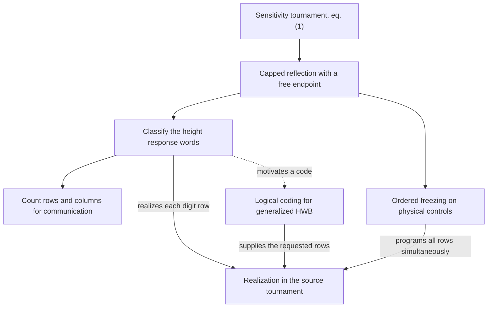
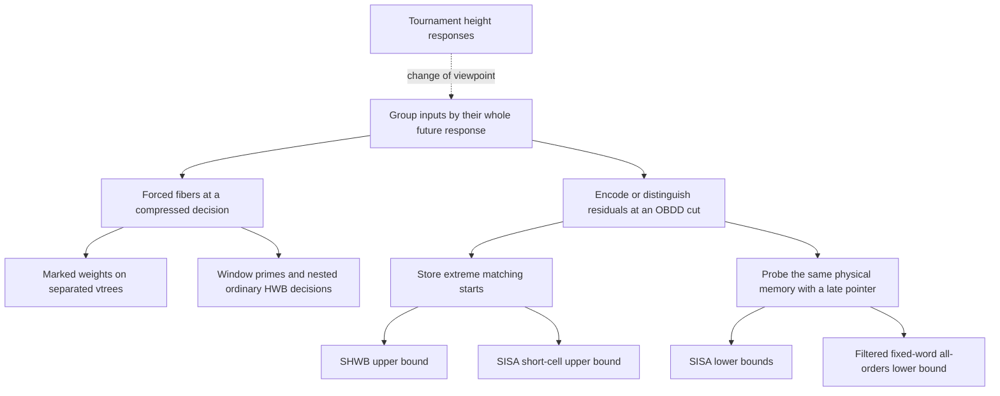

# What can a computation learn about one block of bits?

OpenAI's sensitivity manuscript constructs Boolean functions with unbounded block sensitivity and $\mathrm{bs}(f)\ge s(f)^\alpha$ for some fixed $\alpha>2$. Here sensitivity counts influential single-bit flips at an input, and block sensitivity counts disjoint influential groups, taking the maximum over inputs in each case. The construction uses a recursive tournament of threshold predicates. We asked a different question of that construction. If we leave one block free and fix the rest, **which tests can the surrounding computation perform on that block?** The answer gives exact communication costs and leads to size bounds for decision diagrams on other functions. [Original manuscript, §2.1–2.2, eq. (1), pinned revision](https://github.com/openai/math/tree/4eaee87548250b2682affda7d05d947c05554bae/preprints/A-superquadratic-separation-between-sensitivity-and-block-sensitivity-September-25-2026)

## The step extracted from the AI proof

The chosen child has an integer height $h$, its largest true threshold, with zero when none is true. An outside assignment describes a binary word $w$ indexed by $h$. Put $H=Q-1$ when the child's maximum height is $Q$. Fix the child's siblings. The source clauses reduce to a constant or to the following one-layer map, for $0\le D,E\le H$:

$$
R_{D,E}(h)=\min(D,H-h)\qquad(0\le h\le H).
$$

$$
R_{D,E}(H+1)=E.
$$

Below full height, at most one other row can win. When it tests the chosen child, its other gates impose the cap $D$. At full height a different row can become eligible, supplying the endpoint $E$. If the next computation asks the parent's height the question $w$, the child's question is exactly $w\circ R_{D,E}$. This specifies the operation, its domain and how to compose it. Attaining every choice requires the designated path and independent sibling inputs. It yields **exactly 40 tests on six heights** at depth four. Of the eight possible triples of answers at positions $1,2,3$, precisely $000,001,100,101,111$ occur. The other three positions are free. [Tournament proof](proofs/tournament.md)

## What can travel to a different problem?

For a Boolean function at a partition $A\mid B$, define the **response** to $a$ as the entire function $R_a(b)=f(a,b)$. For each attainable response $g$, define its **fiber** $P_g(a)=[R_a=g]$. Let $\mathcal R$ be the set of all attainable responses. Then

$$
f(a,b)=\bigvee_{g\in\mathcal R}\bigl(P_g(a)\land g(b)\bigr).
$$

At a compressed sentential decision the fiber is the prime that must actually occur. At a cut in an ordered binary decision diagram (OBDD), two prefixes can share a state only if their responses agree on **every** suffix. Conversely, a record determining the residual function gives an upper construction by merging equivalent prefixes at each layer. These are standard facts about decision diagrams. [Darwiche, IJCAI 2011, §2, Theorem 3](https://ijcai.org/proceedings/2011/143) gives the unique compressed partition obtained by grouping assignments whose restrictions agree. Each application must supply the mathematics of its own responses. A lower-bound probe, for example, must supply **one common physical completion** on which two prefixes disagree. [Bova's paper, §2](https://cdn.aaai.org/ojs/10107/10107-13-13635-1-2-20201228.pdf)

**Inside the source construction and Bova's coded witness**

**What the other proofs use**

Solid arrows mark a construction or result actually used in the next argument. Dotted arrows mark methodological inspiration, not a logical dependency. Removing the tournament theorem would remove the realization of the code rows in the source. The code-capacity calculation and the diagram lower bounds have their own proofs.

## New manuscript: FBDD equivalence

[Paper 1 and the stages leading to it](https://hys-ops.github.io/residual-response-tool/) · [GitHub summary and manuscript downloads](proofs/fbdd-equivalence.md)

## Read a proof

| Result | Where the method enters | What the proof establishes |
| --- | --- | --- |
| [Tournament response tables and communication](proofs/tournament.md) | Compose capped reflections and classify the words. | Exact deterministic communication in both directions at a designated child cut. |
| [Generalized HWB with fewer logical inputs](proofs/generalized-code.md) | Count signed responses consistent with a prescribed setting. | Exact auxiliary-bit budget with Bova's prime partition and a recoverable HWB slice. |
| [Programming actual tournament controls](proofs/raw-controls.md) | Follow the entries that freeze when a physical control varies. | Exactly seven raw controls for 128 jointly available positive tags. Three logical bits can select the eight settings. |
| [The cubic cost on separated vtrees](proofs/separated.md) | Trace a forced weight-and-bit fiber down either side of the tree. | Original generalized HWB costs $\Theta(n^3)$ wires at an $X\mid Y$ root. Plain weight lookup costs $\Theta(n^2)$. |
| [One or two adjacent decisions for ordinary HWB](proofs/restricted.md) | Select the all-one response and read an entire window through its prime. | Matching growth rates in two restricted circuit classes. |
| [Ordinary HWB on all vtrees](proofs/hwb-all-vtrees.md) | Iterate response selection and share the circuits produced on dyadic blocks. | Optimal compressed-SDD size $n^{\Theta(\log n)}$. |
| [Shifted hidden weighted bit, SHWB](proofs/shwb.md) | Transfer an exact zero-output cofactor and count comparisons at the same attainable weight. | Optimal OBDD size for every output width. |
| [Shifted indirect storage access, SISA](proofs/sisa.md) | Keep compatible pages as the pointer emerges. Use an unread physical pointer for the lower bound. | Optimal free-output size at every width, plus the easiest and hardest fixed-word rates. |
| [A fixed indirect-address word hard in every order](proofs/sisa-filtered.md) | Force distinct response vectors in many data pages while one pointer remains programmable. | Matching upper and lower powers of $n$ for one explicit address-filtered family. |

A compressed SDD here is a shared circuit with mutually exclusive, exhaustive left primes and pairwise inequivalent right subs at each decision. Its size counts wires. An ordinary OBDD tests input bits in a single order along every path, may skip tests, and shares two terminals. Its size here counts internal vertices. All logarithms are binary. The linked pages state the theorems, explain the main proof arguments, and distinguish Lean-checked results from written reasoning. For ordinary HWB, the [standalone proof and Lean replay](proofs/hwb-all-vtrees.md#what-was-verified) and the [restricted proofs and Lean replay](proofs/restricted.md) are available from their result pages. Other entries state their available proof and replay scope individually. These AI-assisted research notes are offered for mathematical review. Independent human verification and historical priority are open.
