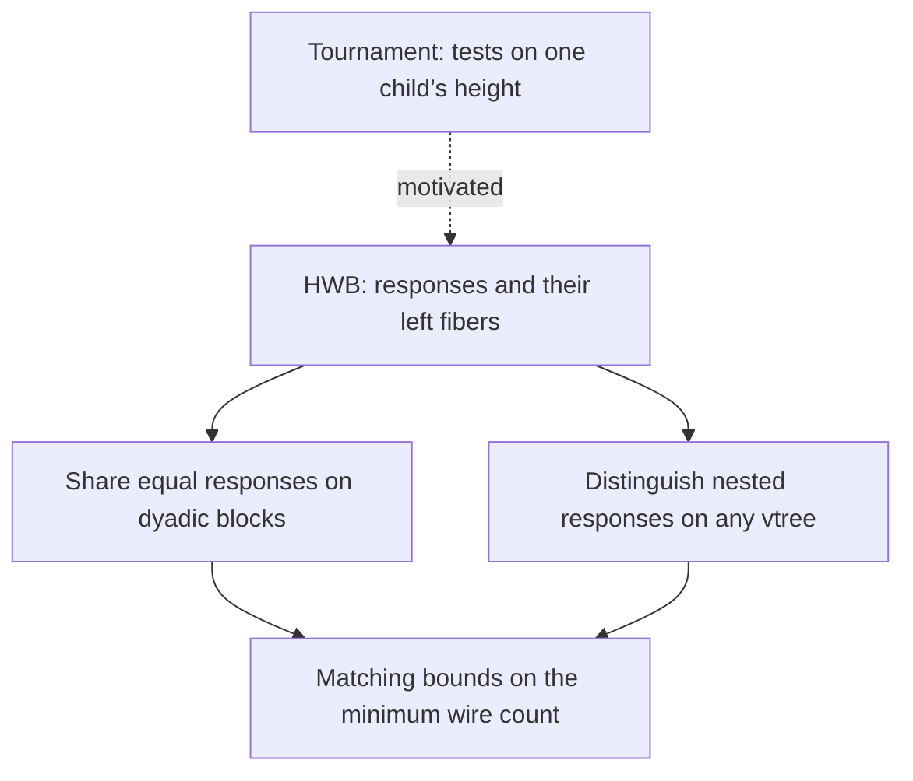

# The optimal compressed SDD size of hidden weighted bit

**Bova’s question.** Does the ordinary hidden weighted bit function require superpolynomial compressed SDD size for every choice of variable tree? Bova asked this in §4 of his AAAI 2016 paper, p. 934. [Published paper](https://cdn.aaai.org/ojs/10107/10107-13-13635-1-2-20201228.pdf#page=6)

**Yes.** Let $S_*(n)$ be the minimum number of directed wires in a compressed sentential decision diagram (SDD) computing $\mathrm{HWB}_n$, over all admissible variable trees (vtrees). Then

$$
\boxed{\quad S_*(n)=2^{\Theta((\log_2 n)^2)}=n^{\Theta(\log_2 n)}.\quad}
$$

**Full proof and verification** · [Standalone proof (PDF, 20 pages)](Ordinary_HWB_Bova_Proof.pdf) · [Lean source and replay scripts (ZIP)](ordinary-hwb-all-vtrees-lean.zip) · [From one split to all vtrees (companion PDF)](Ordinary_HWB_From_One_Split_to_All_Vtrees.pdf)

For $x=(x_1,\ldots,x_n)$, put $k=\sum_i x_i$. The output is $x_k$ when $k>0$ and zero when $k=0$. The lower bound holds even if the vtree has arbitrarily many extra, distinctly labelled leaves. For every assignment to those leaves the circuit must still compute the same $\mathrm{HWB}_n(x)$. One explicit vtree using exactly the original $n$ labels attains the upper bound. The theorem determines the growth rate of the **best** tree. Individual trees can cost more. Together with Bova’s cubic uncompressed construction (Theorem 3), the lower bound gives a superpolynomial separation between compressed and uncompressed SDD size for the same function.

## Where the tool came from

The project began with a question about reading AI-generated proofs. When a proof repeatedly opens a recursive block to see what the rest of the computation can learn from it, can we describe all those observations once and use that description elsewhere?

A concrete example occurs in §2.2, equation (1), of OpenAI’s sensitivity manuscript. Fix all inputs outside a selected child of its tournament construction. The child affects the Boolean root only through its *height* $h$, the highest true threshold, with zero for an empty set of true thresholds. The surrounding assignment therefore specifies a word $w$ and the root returns $w_h$. For the selected child at depth $d\ge1$ with seed parameter $M\ge3$ in the companion analysis, the attainable words have an exact description. With $c=\lceil d/2\rceil$,

$$
w\in\{0,1\}^{d+2},\qquad w_c=1\ \Longrightarrow\ w_{c-1}=w_{c+1}=1.
$$

Every word satisfying this condition occurs. At depth four, for instance, there are 40 possible tests on six heights. In Bova’s generalized HWB example, this led to a recoding that uses three auxiliary bits at $n=128$, preserves the prime partition, and recovers HWB at a designated setting. It changes the auxiliary function. The question that led to the result here was what the same viewpoint could reveal with the function fixed to **ordinary HWB**. The tournament classification motivated that question. The HWB proof starts with the following identity. [Sensitivity manuscript, pinned revision](https://github.com/openai/math/tree/4eaee87548250b2682affda7d05d947c05554bae/preprints/A-superquadratic-separation-between-sensitivity-and-block-sensitivity-September-25-2026)

At a split with left input $z$ and right input $y$, write $R_z(y)=f(z,y)$. For each distinct response $g$ that actually occurs, set $P_g(z)=\mathbf 1\{R_z=g\}$. Then

$$
f(z,y)=\bigvee_{g\in\{R_z:z\}} \bigl(P_g(z)\land g(y)\bigr).
$$

Equality here tests the **whole** right-hand function. At a compressed decision, exactly one prime is true on $z$, and its sub must equal $R_z$ on every $y$. Distinct subs thus force the corresponding prime to be precisely $P_g$. This standard property of compression makes the tool useful in both directions. A construction can merge identical responses. A lower bound can select a response, continue inside its forced prime, and distinguish what survives several splits.



## Why the bounds meet

**Upper bound.** Choose a vtree that successively removes right blocks of $1,2,4,8,\ldots$ consecutive variables, truncating the final block. If a response depends only on the block’s Hamming weight, its profile is a word. Within a cell of at most one word length of candidate starts, the first and last matches determine every match between them: the two copies overlap or touch and fix all the symbols tested there. This gives polynomially many continuing symmetric choices per level. If a response distinguishes two assignments of equal weight, the next block absorbs the remaining dependence on individual positions, and the deeper input matters only through its weight. Counting both the response circuits and their prime circuits over $O(\log n)$ blocks gives $n^{O(\log n)}$ wires.

**Lower bound.** Repeated selection of a response can test a pattern in an actual HWB input. For marks $X\subseteq\mathbb N$ and a pattern $B\subseteq\{0,\ldots,h\}$, let $F_{h,B}(X)$ be the set of starts at which the window of width $h+1$ has exactly the marks $B$. Take patterns $A,B$ containing both endpoints $0,h$, and plant a copy of $A$ at each mark of $X$, writing $X+A=\{x+a:x\in X,\ a\in A\}$. If distinct marks of $X$ are more than $2h$ apart, then

$$
F_{h,B}(X+A)=
\begin{cases}X,&B=A,\\ \varnothing,&B\ne A.\end{cases}
$$

A correct query recovers the positions at which the copies were planted. A wrong query erases them. Nesting these tests gives a physical input that distinguishes one sequence of choices from all the others. The all-vtree argument combines these tests with bounds for wide cuts and for paths containing many smaller blocks. In each case it forces $2^{\Omega((\log n)^2)}$ distinguishable responses, accounting for gates shared across branches.

## What was verified

`HWB.Paper.sharp_paper_minimum` proves matching bounds for the same attained minimum in the formal Bova-style circuit model. The forward translation into the scoped graph model preserves the vtree, including unused leaves, as well as semantics, gate sharing and the reachable wire count. The reverse translation preserves the output cone without increasing the wire count.

The lower bound in the Bova-style model covers every admissible vtree with unused padding allowed. The scoped graph argument gives a broader lower bound that also allows circuits to read extra labels, provided they compute ordinary HWB for every assignment to those labels. The explicit upper circuit uses only the original labels.

The recorded clean replay used Lean 4.34.1 to build 70 source modules and passed the fresh kernel audit `PaperArcAudit`. The audited declarations use the standard axioms `propext`, `Classical.choice` and `Quot.sound`. From the extracted ZIP, run the following command.

```sh
python3 replay.py --lean "$(elan which lean)" --fresh-kernel --log-dir replay-logs
```

Lean certifies the formal declarations. Sections 7–8 of the standalone proof compare the encoded syntax with Bova’s English definitions. Independent human review and historical priority remain unestablished.
